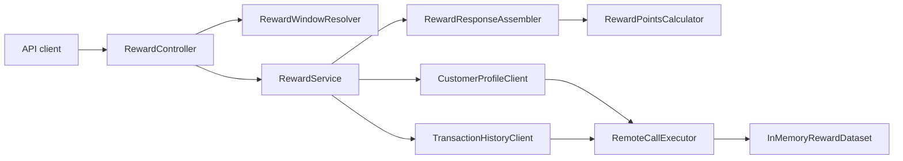

# Customer Rewards Calculator

Retail reward service that scores every purchase on its own, then returns points for one customer or for every customer. Results are broken out by calendar month and as a total. The time window is a request parameter, so a three-month quarter is one call and any other range uses the same endpoint.

## Reward rules

Points are calculated **per transaction**. Monthly totals are the sum of those transaction scores. Two $60 purchases are 10 + 10 points. They are not treated as one $120 purchase.

Only whole dollars count. Cents are truncated toward zero before scoring.

| Whole dollars in the purchase | Points |
| --- | --- |
| Over $100 | 2 points for each of those dollars |
| Over $50, up to $100 | 1 point for each of those dollars |
| $50 or less | 0 points |

A $120 purchase is `2 x $20 + 1 x $50 = 90` points. A $120.99 purchase is still 90, because the cents are dropped before the bands are applied. A $50.00 purchase is 0. A $100.00 purchase is 50.

## Design



The HTTP thread does not block on the sample data source. `RemoteCallExecutor` submits each read to a bounded pool named `txn-fetch-*`, waits with a timeout, and copies the request id onto those threads for the log. Spring MVC returns a `CompletableFuture`, so the servlet thread is released until both reads finish.

`CustomerProfileClient` and `TransactionHistoryClient` are the seams where a real customer or transaction API would replace the in-memory sample. The reward rules themselves live in configuration (`rewards.tiers`) and are applied as marginal bands, highest threshold first. The $120 case is covered by a unit test and by an API test so a configuration change cannot silently drop the published example.

An unknown customer is `404`. A known customer with no purchases in the window is `200` with zero points, and every calendar month in the window is still listed.

### Time window

Use one of these. Mixing them is a `400`.

- `months` and optional `asOf`. `months` defaults to 3. `asOf` defaults to the server's local date. The window starts on the first day of the earliest month and ends on `asOf`, inclusive. `months=3&asOf=2026-09-30` is 1 July 2026 through 30 September 2026.
- `from` and `to`, both required, inclusive. This is the escape hatch for any range up to `rewards.max-range-days` (1126 days).

### Response

Each customer payload includes:

- profile: id, name, email, enrollment date
- the inclusive period and the program rules that were applied
- transaction count, amount spent, and total points
- one row per calendar month in the window, including months with zero points
- each transaction, with the original amount, the whole-dollar amount used for scoring, the category, the description, the points, and the band split

`includeTransactions=false` drops the transaction array and keeps the monthly totals.

## Technical details

| Item | Choice |
| --- | --- |
| Language | Java 8 (`maven.compiler.release` 8). The build is checked with Animal Sniffer against the Java 8 API. |
| Framework | Spring Boot 2.7.18. This is the last open-source Boot line that still runs on Java 8. Boot 3 requires Java 17. |
| API style | JSON REST under `/api/v1` |
| Money | `BigDecimal`, scale 2, serialized as a JSON number with two decimal places |
| Dates | `java.time.LocalDate`. Transaction dates are business dates, not timestamps. |
| Async | `CompletableFuture` plus a bounded `ThreadPoolTaskExecutor`. Java 8 has no `orTimeout`, so the deadline is a scheduled task. |
| Docs | OpenAPI at `/api/v1/openapi`, Swagger UI at `/swagger-ui.html` |
| Health | `/actuator/health` and `/actuator/info` |
| Storage | In-memory sample behind the client interfaces. No database is required to run the assessment scenario. |
| Build output | `target/` is gitignored. Compiled classes, jars, and executables are not part of the source tree. |

Package layout:

| Package | Responsibility |
| --- | --- |
| `controller` | HTTP mapping and query parameters |
| `service` | Window resolution, point calculation, response assembly |
| `client` | Asynchronous profile and transaction reads, sample dataset |
| `model` | `Customer`, `Purchase`, reward tiers |
| `dto` | JSON responses |
| `exception` | 400, 404, 405, 502, 503, and 500 JSON errors |
| `validation` | Customer id format |
| `web` | `X-Request-Id` filter and log-context propagation |
| `config` | Clock, pool, OpenAPI, and reward properties |

## Configuration

`src/main/resources/application.yml`

| Property | Default | Meaning |
| --- | --- | --- |
| `rewards.default-months` | 3 | Used when the caller omits both the month count and an explicit range |
| `rewards.max-months` | 36 | Largest accepted `months` value |
| `rewards.max-range-days` | 1126 | Largest accepted `from`/`to` span |
| `rewards.simulated-latency-ms` | 80 | Artificial downstream delay. The `test` profile sets this to 0. |
| `rewards.fetch-timeout-ms` | 2000 | Fail the read with 502 when the downstream call exceeds this |
| `rewards.fetch-core-pool-size` | 4 | Fetch pool core size |
| `rewards.fetch-max-pool-size` | 16 | Fetch pool max size |
| `rewards.fetch-queue-capacity` | 100 | Queue before `CallerRunsPolicy` |
| `rewards.tiers` | over $100 at 2 points, over $50 at 1 point | Marginal bands |

The app refuses to start when `default-months` is greater than `max-months`, the pool max is below the core size, or two tiers share a threshold.

## API

Base URL: `http://localhost:8080`

| Method | Path | Purpose |
| --- | --- | --- |
| `GET` | `/api/v1/customers` | List customer profiles |
| `GET` | `/api/v1/customers/{customerId}/rewards` | Points for one customer |
| `GET` | `/api/v1/rewards` | Points for every customer |
| `GET` | `/api/v1/openapi` | OpenAPI document |
| `GET` | `/swagger-ui.html` | Swagger UI |
| `GET` | `/actuator/health` | Liveness |
| `GET` | `/actuator/info` | Application name, version, Java target |

`customerId` must match `C` plus 4 digits, for example `C1001`.

### Query parameters

| Name | Type | Required | Notes |
| --- | --- | --- | --- |
| `months` | integer | no | 1 through 36. Defaults to 3 when `from`/`to` are absent. |
| `asOf` | `yyyy-MM-dd` | no | End date of the relative window. Defaults to today. |
| `from` | `yyyy-MM-dd` | with `to` | Inclusive start. Do not send with `months` or `asOf`. |
| `to` | `yyyy-MM-dd` | with `from` | Inclusive end. |
| `includeTransactions` | boolean | no | Default `true`. |

Spring also accepts `true`/`false`, `yes`/`no`, `on`/`off`, and `1`/`0` for the boolean. Any other token is `400`.

### Headers

Send `X-Request-Id` as 8 to 64 letters, digits, or hyphens. The same value is written to the log, echoed on the response, and copied into error JSON. Any other value is replaced with a generated id so it cannot break the log format.

### Success, one customer

`GET /api/v1/customers/C1001/rewards?from=2026-07-01&to=2026-09-30`

Maya Chen's five purchases in that quarter score **415** points: July 115, August 50, September 250. Spend is **545.49**. The $120 headphones transaction is the published 90-point example (`20 x 2` plus `50 x 1`). The October grocery run is outside this window and is not included.

```json
{
  "customer": {
    "customerId": "C1001",
    "firstName": "Maya",
    "lastName": "Chen",
    "fullName": "Maya Chen",
    "email": "maya.chen@example.com",
    "enrolledOn": "2024-03-15"
  },
  "period": {
    "startDate": "2026-07-01",
    "endDate": "2026-09-30",
    "monthCount": 3
  },
  "programRules": [
    "1 point for each whole dollar over $50 up to $100.",
    "2 points for each whole dollar over $100.",
    "A whole dollar at or below $50 earns no points.",
    "Cents are truncated before points are calculated.",
    "Points are awarded on each transaction and are not recalculated from the monthly total."
  ],
  "transactionCount": 5,
  "totalSpent": 545.49,
  "totalPoints": 415,
  "monthlyRewards": [
    { "year": 2026, "month": 7, "monthLabel": "July 2026", "transactionCount": 2, "totalSpent": 195.50, "points": 115 },
    { "year": 2026, "month": 8, "monthLabel": "August 2026", "transactionCount": 2, "totalSpent": 149.99, "points": 50 },
    { "year": 2026, "month": 9, "monthLabel": "September 2026", "transactionCount": 1, "totalSpent": 200.00, "points": 250 }
  ],
  "transactions": [
    {
      "transactionId": "T10011",
      "transactionDate": "2026-07-04",
      "amount": 120.00,
      "wholeDollarAmount": 120,
      "category": "ELECTRONICS",
      "description": "Wireless headphones",
      "points": 90,
      "bands": [
        { "rule": "2 points for each whole dollar over $100", "dollars": 20, "pointsPerDollar": 2, "points": 40 },
        { "rule": "1 point for each whole dollar over $50 up to $100", "dollars": 50, "pointsPerDollar": 1, "points": 50 }
      ]
    }
  ]
}
```

The live payload includes every transaction, not only the headphones row shown above.

The same 415-point result is returned by:

```text
GET /api/v1/customers/C1001/rewards?months=3&asOf=2026-09-30
```

### Success, every customer

`GET /api/v1/rewards?from=2026-07-01&to=2026-09-30`

| Field | Value |
| --- | --- |
| Customers | 5 |
| Transactions inside the window | 14 |
| Total spend | 1352.24 |
| Total points | 950 |

Per customer for that quarter:

| Customer | Points | Why it is in the sample |
| --- | --- | --- |
| C1001 Maya Chen | 415 | Mix of under $50, $50-$100, and over $100, including the $120 = 90 example |
| C1002 Luis Ortega | 350 | $250.75 speaker is 350 points; $40 and $50 earn nothing |
| C1003 Priya Nair | 50 | $50.00 and $50.01 earn 0; $100.99 earns 50 |
| C1004 Jonah Blake | 45 | No July purchases (month still returned as 0); 30 August + 15 on 30 September |
| C1005 Elena Rossi | 90 | June $500 camera is excluded; September coat is 90 |

### Errors

Every error body has the same shape:

```json
{
  "timestamp": "2026-10-12T17:10:00Z",
  "status": 404,
  "error": "Not Found",
  "message": "Customer C9999 was not found.",
  "path": "/api/v1/customers/C9999/rewards",
  "requestId": "rewards-test-404"
}
```

| Status | When |
| --- | --- |
| 400 | Bad customer id, mixed window parameters, half of a date range, `from` after `to`, `months` outside 1-36, a range over 1126 days, or a query value of the wrong type |
| 404 | Unknown customer, or no such path |
| 405 | Method other than GET |
| 502 | Downstream read failed or timed out |
| 503 | The HTTP request itself exceeded the async timeout |
| 500 | Unexpected failure. The client message is generic. The stack stays in the log. |

## Sample data

Twenty purchases for five customers, from June through October 2026. Points below are the score of that purchase alone.

### C1001 Maya Chen

| Id | Date | Amount | Points |
| --- | --- | --- | --- |
| T10011 | 2026-07-04 | 120.00 | 90 |
| T10012 | 2026-07-18 | 75.50 | 25 |
| T10013 | 2026-08-02 | 49.99 | 0 |
| T10014 | 2026-08-20 | 100.00 | 50 |
| T10015 | 2026-09-11 | 200.00 | 250 |
| T10016 | 2026-10-05 | 60.00 | 10 |

### C1002 Luis Ortega

| Id | Date | Amount | Points |
| --- | --- | --- | --- |
| T10021 | 2026-07-09 | 40.00 | 0 |
| T10022 | 2026-08-14 | 250.75 | 350 |
| T10023 | 2026-09-28 | 50.00 | 0 |
| T10024 | 2026-10-02 | 101.99 | 52 |

### C1003 Priya Nair

| Id | Date | Amount | Points |
| --- | --- | --- | --- |
| T10031 | 2026-07-01 | 50.00 | 0 |
| T10032 | 2026-08-15 | 50.01 | 0 |
| T10033 | 2026-09-01 | 100.99 | 50 |
| T10034 | 2026-10-08 | 101.00 | 52 |

### C1004 Jonah Blake

| Id | Date | Amount | Points |
| --- | --- | --- | --- |
| T10041 | 2026-08-22 | 80.00 | 30 |
| T10042 | 2026-09-30 | 65.00 | 15 |
| T10043 | 2026-10-01 | 30.00 | 0 |

### C1005 Elena Rossi

| Id | Date | Amount | Points |
| --- | --- | --- | --- |
| T10051 | 2026-06-15 | 500.00 | 850 |
| T10052 | 2026-09-19 | 120.00 | 90 |
| T10053 | 2026-10-11 | 45.00 | 0 |

T10051 is the row that proves date filtering. It scores 850 points and is absent from a July-September result.

## Logging and exceptions

Application logs go through SLF4J. There are no `System.out` or `printStackTrace` calls. Each line carries the request id when one is in scope.

Info logs record the customer id, window, transaction count, and total points. They do not record email addresses. Validation failures are warnings. Downstream and unexpected failures are errors with a stack trace. Unexpected responses do not include that stack trace.

Customer ids, purchase amounts, and descriptions are checked when the sample data is constructed. A duplicate id or a negative amount prevents startup instead of shipping a bad dataset.

## Run

Requires JDK 8 or newer (the bytecode target is 8) and Maven 3.6+.

```bash
mvn spring-boot:run
```

On Windows PowerShell, call `curl.exe` so the command is not aliased to `Invoke-WebRequest`:

```powershell
curl.exe "http://localhost:8080/api/v1/customers/C1001/rewards?from=2026-07-01&to=2026-09-30"
curl.exe "http://localhost:8080/api/v1/rewards?months=3&asOf=2026-09-30"
curl.exe "http://localhost:8080/actuator/health"
```

Swagger UI: [http://localhost:8080/swagger-ui.html](http://localhost:8080/swagger-ui.html)

## Tests

```bash
mvn test
```

The `test` profile sets the simulated latency to 0 so the suite does not wait on the artificial delay. One test still uses a 50 ms timeout against a 1 second sleep to prove the downstream deadline fires.

Latest run: **Tests run: 66, Failures: 0, Errors: 0, Skipped: 0.**

| Suite | What it locks |
| --- | --- |
| `RewardPointsCalculatorTest` | 90 points for $120, band split, boundaries at $50 and $100, truncated cents, negative and oversized amounts, duplicate tiers |
| `RewardWindowResolverTest` | Default 3 months, `asOf`, explicit range, mixed parameters, reversed dates, max length |
| `RewardServiceTest` | Two $60 purchases score 20 rather than 90, empty months stay in the result, unknown customer does not fetch transactions, downstream failure propagates |
| `DomainValidationTest` | Negative money, more than two decimal places, bad email, bad customer id |
| `InMemoryRewardDatasetTest` | 5 customers, 20 purchases, June camera outside the quarter, 30 September included |
| `RemoteCallExecutorTest` | Work runs on `txn-fetch-*`, the delay is invoked, and a slow call returns the timeout error |
| `RewardApiTest` | Maya 415 points, quarter report 950 points, Elena's June purchase excluded, zero-point month, cent boundaries, summary mode, 400/404/405, request id, health, OpenAPI |

## Source control

Compiled output is ignored (`.gitignore` excludes `target/`, `*.class`, `*.jar`, `*.war`, and `*.exe`). History is the source tree only. Commit messages describe why the change exists.

## What a later production cut would add

The calculation, validation, and HTTP contract can stay. The next cut would replace `SimulatedCustomerProfileClient` and `SimulatedTransactionHistoryClient` with HTTP clients, add authentication at the gateway, and page transaction history if a single window can return more rows than this sample.
